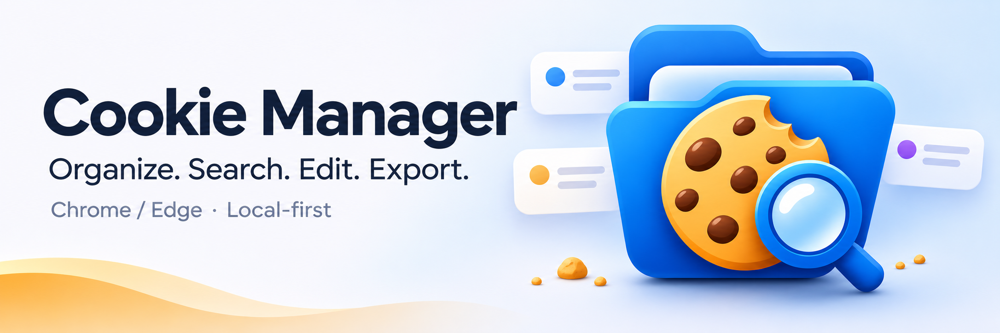

<div align="center">



# Cookie Manager

A Chrome / Edge extension to categorize, search, edit, import, export, and delete cookies by site, and to clear cache, Local Storage, IndexedDB, and other site data. All data stays on your device.

[繁體中文](README.md) | **English**

[Website](https://cookie-manager.stack-base.com/) · [Privacy Policy](https://cookie-manager.stack-base.com/privacy.html)


</div>

## Table of Contents

- [Features](#features)
- [Installation](#installation)
- [Scripts](#scripts)
- [Tech Stack](#tech-stack)
- [Project Structure](#project-structure)
- [Auto-categorization](#auto-categorization)
- [Localization](#localization)
- [Privacy and Permissions](#privacy-and-permissions)
- [Known Limitations](#known-limitations)
- [Contributing](#contributing)

## Features

### Dashboard

- Cookies grouped by main site (e.g. `.mail.google.com` is grouped under `google.com`)
- Auto-categorization: 13 built-in categories, with sites assigned automatically by domain (see [Auto-categorization](#auto-categorization))
- Custom categories: add, rename, pick colors (Apple system colors or a custom color), reorder, delete; manual assignments take priority over auto-categorization
- Search by site, cookie name, or domain
- Delete a single cookie, all cookies of a site, or several selected sites at once
- Move selected sites to a category or export them in bulk
- Cookie details: value, domain, path, expiry, Secure / HttpOnly / SameSite flags, with value copy
- Export cookies as JSON, Netscape (cookies.txt), or header string, as a file download or to the clipboard
- Export the site list as CSV, JSON, or TXT for the current view, all sites, or selected sites (no cookie contents)
- Import site categories: edit the exported CSV in Excel, or have an AI edit the exported JSON, then import it; new category names are created automatically
- Back up and restore category settings (backups never include cookie contents)
- The list refreshes automatically when cookies change

### Toolbar popup

- List the current tab's cookies, switch between "This page" and "Whole site" scope, and search
- Create, edit, and delete cookies (name, value, domain, path, expiry, SameSite, Secure, HttpOnly)
- Import and export cookies (JSON, Netscape, header string); the import format is detected automatically
- Delete all cookies of the current tab in one click
- Assign a category to the current site and open the dashboard

### Site data (cache & storage)

- Clear data for the current site, scoped to "This page" or "Whole site", optionally reloading the page afterwards
- From the dashboard, clear specific sites or origins, clear several selected sites at once, or clear all sites with an exclusion list and a time range
- Data types: HTTP cache, Cache Storage, service workers, Local Storage, IndexedDB, file systems & WebSQL, and cookies; only cache types are selected by default, so you stay signed in
- Inspect the current page's storage and usage: view, edit, and delete Local / Session Storage items; delete individual IndexedDB databases and Cache Storage caches; unregister service workers

### General

- UI available in Traditional Chinese, Simplified Chinese, English, Japanese, German, Korean, French, Russian, and Spanish; follows the browser language by default and can be switched manually
- Dark mode

## Installation

### Install from the Chrome Web Store (recommended)

Open the [Chrome Web Store page](https://chromewebstore.google.com/detail/cookie-manager/cepibofjjkncodmjaekeonggofoalcjb) and click "Add to Chrome". Updates are installed automatically. Microsoft Edge can also install it from the Chrome Web Store.

### Download from GitHub

You can also download the prebuilt extension from [GitHub Releases v0.2.0](https://github.com/bruce-yang-422/CookieManager/releases/tag/v0.2.0); no build is required.

1. Download `cookie-manager-v0.2.0.zip` from the release assets and extract it (do not select Source code).
2. Open `chrome://extensions` (`edge://extensions` in Edge).
3. Enable **Developer mode** and click **Load unpacked**.
4. Select the extracted folder containing `manifest.json`.

The following instructions are for building from source. Node.js is required only for that workflow.

### Prerequisites

- [Node.js](https://nodejs.org/) 20 or later
- Google Chrome or Microsoft Edge

### Build

```bash
git clone https://github.com/bruce-yang-422/CookieManager.git
cd CookieManager
npm install
npm run build
```

The build output goes to the `extension/` folder.

### Load in the browser

1. Open `chrome://extensions` (`edge://extensions` in Edge)
2. Turn on **Developer mode** in the top-right corner
3. Click **Load unpacked** and select the `extension/` folder

After pulling new code and rebuilding, click the reload button (↻) on the extension's card.

## Scripts

| Command | Description |
| --- | --- |
| `npm run build` | Type-check and build to `extension/` |
| `npm run watch` | Watch for changes and rebuild to `extension/` automatically |
| `npm run typecheck` | Run type checking only |
| `npm run icons` | Generate PNG icons in all sizes from the source image `assets/icons/logo.png` |

## Tech Stack

| Area | Technology |
| --- | --- |
| Extension platform | Chrome Manifest V3 |
| Build tool | [Vite](https://vite.dev/) + [CRXJS](https://crxjs.dev/) |
| Framework | [Vue 3](https://vuejs.org/) (Composition API) |
| UI library | [Naive UI](https://www.naiveui.com/) |
| Language | TypeScript (strict mode) |
| Storage | `chrome.storage.local` (local only, no backend) |
| Site data | `chrome.browsingData` (clearing), `chrome.scripting` (inspecting and managing storage in the tab) |

## Project Structure

```text
CookieManager/
├── src/
│   ├── background/        # Service worker (opens the dashboard on first install)
│   ├── popup/             # Toolbar popup
│   │   └── components/    # Cookie editor form, import panel, export panel, site data panel
│   ├── dashboard/         # Dashboard
│   │   └── components/    # Cookie details, category manager, export dialog, clear site data dialog
│   ├── lib/               # Cookie and site data operations, auto-categorization rules, import/export formats, category backup, shared components
│   ├── i18n/              # UI translations
│   │   └── locales/       # Nine complete UI dictionaries (zh-TW.ts is primary)
│   ├── storage/           # Category data read/write
│   └── styles/            # Shared styles
├── public/_locales/       # Extension name and description translations (Chrome format)
├── assets/icons/          # Extension icons (logo.png is the source image, logo.ico is the website favicon)
├── scripts/               # Build helper scripts (icon generation)
├── StoreAssets/           # Chrome Web Store images and listing text
├── index.html             # Project website (GitHub Pages)
├── privacy.html           # Privacy policy
├── site/                  # Shared styles and language switching for the website
├── manifest.config.ts     # Manifest configuration
└── vite.config.ts         # Vite configuration
```

`extension/` (build output) and `node_modules/` are not under version control.

## Auto-categorization

The dashboard assigns sites to the built-in categories automatically, based on their domain:

| Category | Rule |
| --- | --- |
| Work, Social, Shopping, Entertainment, News & Media, Search & Portals, Development, Tech Brands & Telecom, Lifestyle & Services, Finance | Known domain lists (about 2,100 domains covering popular sites in Taiwan, Japan, the US, the UK, and internationally) |
| Government & Education | Domain suffixes such as `.gov.tw`, `.edu.tw`, `.go.jp`, `.gov.uk`, and `.gov.au`, plus online courses, exams, and academic databases |
| Local & Network | IP addresses, `localhost`, `.local`, and similar |
| Ads & Tracking | Known domain list, plus common ad and tracking domain names |

- Sites that match no rule stay uncategorized.
- Manual assignments (including explicitly marking a site as uncategorized) always take priority and are never overwritten by auto-categorization.
- Auto-assigned category labels have a dashed outline; manual ones have a solid outline.
- Auto-categorization can be turned off from the "⋯" menu in the top-right corner of the dashboard.
- Built-in categories can be renamed, recolored, or deleted; once deleted, sites are no longer auto-assigned to them.
- Built-in category names follow the interface language until you rename them; renamed categories always show your custom name.
- The rules live in `src/lib/autoCategory.ts`; to add a domain, add it to the matching category's list.

### Bulk-editing categories with Excel or AI

1. In the dashboard, choose "⋯ > Export site list" and pick CSV (for Excel) or JSON (for AI)
2. Change each site's category:
   - CSV: edit the Category column with an existing category name, a new name (created automatically), or "Uncategorized"
   - JSON: the file includes a `_readme` with instructions and the list of available `categories`, so you can hand it to an AI to edit `category`
3. Choose "⋯ > Import site categories", select the edited file, and confirm

Only sites whose category differs from the current one are changed, and those become manual assignments; unchanged sites stay as they are. CSV files saved by Excel in Big5 or Shift_JIS are also supported.

## Localization

Supported languages: Traditional Chinese (`zh-TW`), Simplified Chinese (`zh-CN`), English (`en`), Japanese (`ja`), German (`de`), Korean (`ko`), French (`fr`), Russian (`ru`), and Spanish (`es`).

- **UI language**: follows the browser language by default. Simplified-Chinese regions use `zh-CN`, every other supported language uses its matching locale, and unsupported languages fall back to English. Switch it from the popup or dashboard; the setting syncs across all pages.
- **Translation files**: `src/i18n/locales/`. `zh-TW.ts` is the primary language, and every other language file must contain the same keys; `npm run typecheck` reports any missing key.
- **Technical terms**: standard Web terms such as Cookie, Local Storage, Session Storage, IndexedDB, Service Worker, Cache Storage, HttpOnly, SameSite, JSON, and Netscape remain in English in every locale.
- **Legacy import encodings**: Shift_JIS for Japanese, Big5 for Traditional Chinese, GB18030 for Simplified Chinese, and Windows-1252 as the fallback for other locales when UTF-8 decoding fails.
- **Parameters and plurals**: `{name}` in a message is replaced by a parameter. When singular and plural differ, write `"singular | plural"`; the form is chosen by the `n` parameter.
- **Extension name and description**: `public/_locales/<language>/messages.json`.

### Adding a language

1. Copy `src/i18n/locales/en.ts` to a new file (for example `ko.ts`) and translate it
2. Add the language to `LOCALES`, `DICTIONARIES`, `NAIVE_LOCALES`, and `detect()` in `src/i18n/index.ts`
3. Add `public/_locales/<language>/messages.json`

## Privacy and Permissions

- Collects and transmits no user data; there is no backend server
- No analytics, advertising, or third-party services
- No remote code is loaded
- Site data (cache and storage) is read and cleared only on your device, and clearing happens only when you start it
- Exported cookie files are downloaded straight to your device; they contain login credentials, so keep them safe

See the full [Privacy Policy](https://cookie-manager.stack-base.com/privacy.html).

| Permission | Purpose |
| --- | --- |
| `cookies` | Read, create, edit, and delete cookies |
| `storage` | Store category settings and site data clearing settings locally |
| `favicon` | Show site icons from the browser cache |
| `browsingData` | Clear site cache, Cache Storage, Local Storage, IndexedDB and other site data |
| `scripting` | View and manage Local Storage, IndexedDB, Cache Storage and service workers in the current tab |
| `<all_urls>` | Manage cookies and site data for any site |

## Known Limitations

- Incognito cookies are not listed
- Partitioned cookies (CHIPS) are not listed
- The main site is determined by built-in rules, so a few unusual domains may be grouped imprecisely
- Auto-categorization relies on domain lists and naming rules, so some sites may be miscategorized or left uncategorized; you can correct them manually
- When cookies are cleared by site, the browser clears cookies for the whole registrable domain; excluding a site also keeps cookies for the whole registrable domain
- The browser cannot list which origins hold data, so clearing a whole site only covers subdomains found in cookies and open tabs
- "Inspect storage" reads only the top-level page of the current tab, not embedded frames; protected pages such as the Chrome Web Store cannot be read
- Session Storage cannot be removed by the browser's clearing API; clear it manually in the "Site data" panel
- The browser does not report HTTP cache usage per site, so storage usage excludes the HTTP cache

## Contributing

Issues and pull requests are welcome. Before submitting, please make sure that:

- `npm run build` passes (including type checking)
- UI text changes are applied to every language file under `src/i18n/locales/`
- README changes are applied to both [README.md](README.md) (Traditional Chinese) and [README.en.md](README.en.md) (English)
