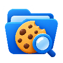

<div align="center">



# Cookie Manager

依網站分類、搜尋、編輯、匯入匯出與刪除 Cookie 的 Chrome / Edge 擴充功能。所有資料只存在本機。

**繁體中文** | [English](README.en.md)

[介紹網站](https://cookie-manager.stack-base.com/) · [隱私權政策](https://cookie-manager.stack-base.com/privacy.html)


</div>

## 目錄

- [功能特色](#功能特色)
- [安裝](#安裝)
- [開發指令](#開發指令)
- [技術架構](#技術架構)
- [專案結構](#專案結構)
- [多國語言](#多國語言)
- [隱私權與權限](#隱私權與權限)
- [已知限制](#已知限制)
- [參與貢獻](#參與貢獻)

## 功能特色

### 管理後台

- 依主網站合併顯示 Cookie（例如 `.mail.google.com` 歸在 `google.com`）
- 自訂分類：新增、改名、選顏色、調整順序、刪除
- 搜尋網站、Cookie 名稱或網域
- 刪除單一 Cookie、單一網站的所有 Cookie，或勾選多個網站批次刪除
- 批次將網站移至分類或匯出
- Cookie 明細：值、網域、路徑、到期時間、Secure / HttpOnly / SameSite 屬性，可複製值
- 匯出 Cookie：支援 JSON、Netscape（cookies.txt）與 Header 字串，可下載檔案或複製到剪貼簿
- 備份與還原分類設定（備份檔不含 Cookie 內容）
- Cookie 有變動時自動更新列表

### 工具列小視窗

- 列出目前分頁的 Cookie，可切換「此頁面」或「整個網站」範圍，並可搜尋
- 建立、編輯與刪除 Cookie（名稱、值、網域、路徑、到期時間、SameSite、Secure、HttpOnly）
- 匯入與匯出 Cookie（JSON、Netscape、Header 字串），匯入時自動判斷格式
- 一鍵刪除目前分頁的所有 Cookie
- 替目前網站設定分類、開啟管理後台

### 共通

- 介面支援繁體中文、English、日本語，預設跟隨瀏覽器語言，可手動切換
- 支援深色模式

## 安裝

目前尚未上架 Chrome 線上應用程式商店，需自行打包後載入。

### 環境需求

- [Node.js](https://nodejs.org/) 20 以上
- Google Chrome 或 Microsoft Edge

### 打包

```bash
git clone https://github.com/bruce-yang-422/CookieManager.git
cd CookieManager
npm install
npm run build
```

打包結果會輸出到 `extension/` 資料夾。

### 載入瀏覽器

1. 開啟 `chrome://extensions`（Edge 為 `edge://extensions`）
2. 開啟右上角的 **開發人員模式**
3. 點選 **載入未封裝項目**，選擇 `extension/` 資料夾

之後更新程式碼並重新打包，到擴充功能頁面按該擴充功能的重新載入（↻）即可。

## 開發指令

| 指令 | 說明 |
| --- | --- |
| `npm run build` | 型別檢查並打包到 `extension/` |
| `npm run watch` | 監看檔案變更，自動重新打包到 `extension/` |
| `npm run typecheck` | 只執行型別檢查 |
| `npm run icons` | 由 `assets/icons/logo.png` 原圖產生各尺寸 PNG 圖示 |

## 技術架構

| 項目 | 使用技術 |
| --- | --- |
| 擴充功能規格 | Chrome Manifest V3 |
| 建置工具 | [Vite](https://vite.dev/) + [CRXJS](https://crxjs.dev/) |
| 前端框架 | [Vue 3](https://vuejs.org/)（Composition API） |
| UI 元件庫 | [Naive UI](https://www.naiveui.com/) |
| 程式語言 | TypeScript（strict 模式） |
| 資料儲存 | `chrome.storage.local`（純本機，無後端） |

## 專案結構

```text
CookieManager/
├── src/
│   ├── background/        # Service Worker（首次安裝時開啟管理後台）
│   ├── popup/             # 工具列小視窗
│   │   └── components/    # Cookie 編輯表單、匯入面板、匯出面板
│   ├── dashboard/         # 管理後台
│   │   └── components/    # Cookie 明細、分類管理、匯出視窗
│   ├── lib/               # Cookie 操作、匯入匯出格式、分類備份、共用元件
│   ├── i18n/              # 介面翻譯
│   │   └── locales/       # zh-TW.ts（主要）、en.ts、ja.ts
│   ├── storage/           # 分類資料讀寫
│   └── styles/            # 共用樣式
├── public/_locales/       # 擴充功能名稱與說明的翻譯（Chrome 格式）
├── assets/icons/          # 擴充功能圖示（logo.png 為原圖）
├── scripts/               # 建置輔助腳本（產生圖示）
├── index.html             # 介紹網站（GitHub Pages）
├── privacy.html           # 隱私權政策
├── site/                  # 介紹網站共用的樣式與語言切換
├── manifest.config.ts     # Manifest 設定
└── vite.config.ts         # Vite 設定
```

`extension/`（打包結果）與 `node_modules/` 不納入版本控制。

## 多國語言

支援繁體中文（`zh-TW`）、English（`en`）、日本語（`ja`）。

- **介面語言**：預設跟隨瀏覽器語言（中文 → 繁體中文、日文 → 日本語、其他 → English），可在小視窗或管理後台右上角的語言選單切換，設定會在所有頁面同步。
- **翻譯檔**：`src/i18n/locales/`。`zh-TW.ts` 是主要語言，其他語言檔必須包含相同的 key，缺少時 `npm run typecheck` 會報錯。
- **參數與單複數**：訊息中的 `{name}` 會被參數取代；需要區分單複數時寫成 `"單數 | 複數"`，依參數 `n` 選擇。
- **擴充功能名稱與說明**：`public/_locales/<語言>/messages.json`。

### 新增語言

1. 複製 `src/i18n/locales/en.ts` 為新語言檔（例如 `ko.ts`）並翻譯
2. 在 `src/i18n/index.ts` 的 `LOCALES`、`DICTIONARIES`、`NAIVE_LOCALES` 與 `detect()` 加入新語言
3. 新增 `public/_locales/<語言>/messages.json`

## 隱私權與權限

- 不收集、不傳送任何使用者資料，沒有後端伺服器
- 不使用分析工具、廣告或任何第三方服務
- 不載入遠端程式碼
- 匯出的 Cookie 檔案直接下載到本機；檔案含有登入憑證，請妥善保管

完整內容請見 [隱私權政策](https://cookie-manager.stack-base.com/privacy.html)。

| 權限 | 用途 |
| --- | --- |
| `cookies` | 讀取、建立、編輯與刪除 Cookie |
| `storage` | 在本機儲存分類設定 |
| `favicon` | 從瀏覽器快取顯示網站圖示 |
| `<all_urls>` | 管理任何網站的 Cookie |

## 已知限制

- 不會列出無痕模式的 Cookie
- 不會列出分區 Cookie（CHIPS）
- 主網站使用內建規則判斷，少數特殊網域可能歸類不精確

## 參與貢獻

歡迎提出 Issue 或 Pull Request。提交前請確認：

- `npm run build` 可以通過（包含型別檢查）
- 修改介面文字時，同時更新 `src/i18n/locales/` 下所有語言檔
- 修改 README 時，同時更新 [README.md](README.md)（繁體中文）與 [README.en.md](README.en.md)（English）
